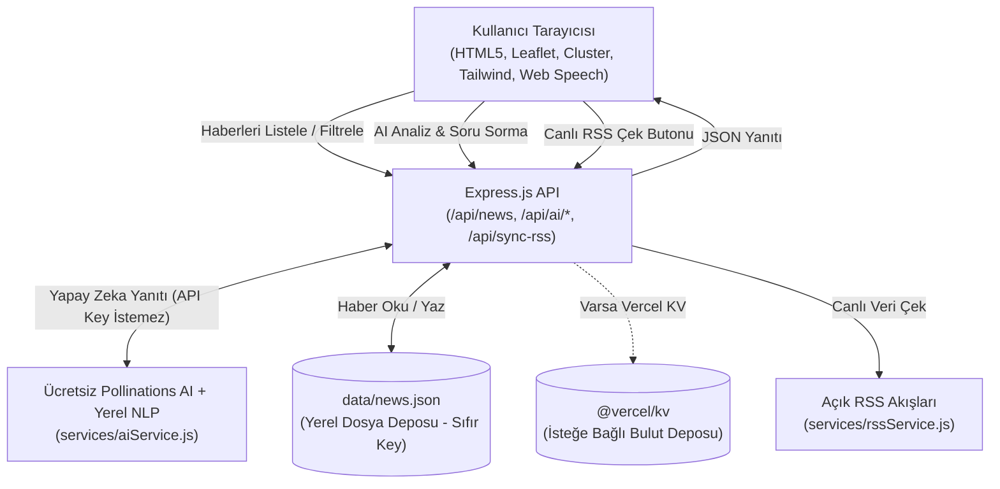

# 💧 Dünya Su Haberleri (Global Water Watch)

> **%100 Ücretsiz & API Key İstemeyen Küresel Su Yönetimi, Baraj Projeleri ve Kuraklık İzleme Platformu**

Dünya Su Haberleri, yerküre genelindeki stratejik su kaynakları, sınır aşan nehir havzaları, kuraklık krizleri, arıtma teknolojileri ve uluslararası su paylaşım protokollerini interaktif bir harita üzerinde bir araya getiren, **hiçbir harici ücretli servis veya API anahtarına ihtiyaç duymayan (%100 Zero-API-Key)** açık kaynaklı bir izleme ve yapay zeka analiz platformudur.

---

## 🛡️ %100 Ücretsiz & API Anahtarsız Mimari

Uygulamanın tüm işlevleri **kesinlikle hiçbir kayıt, kredi kartı veya API anahtarı istemeyen** açık kamu servisleri ve yerel motorlarla çalışacak şekilde tasarlanmıştır:

| İşlev / Servis | Kullanılan Çözüm | Lisans / Maliyet | API Key İhtiyacı |
| :--- | :--- | :--- | :--- |
| **Yapay Zeka (AI Analiz & Sohbet)** | Pollinations AI Açık Metin API + Yerel Kural Motoru | Ücretsiz / Açık | ❌ **İSTEMEZ** |
| **Coğrafi Harita (Sokak & Şehir)** | Resmi OpenStreetMap Standard (OSM) | ODbL / Açık | ❌ **İSTEMEZ** |
| **Topografik Havza Haritası** | OpenTopoMap (Yükseklik & Nehir Yatakları) | Ücretsiz / Açık | ❌ **İSTEMEZ** |
| **Fiziksel Uydu Görüntüleri** | Esri World Imagery Tiling | Ücretsiz Kamu Servisi | ❌ **İSTEMEZ** |
| **Harita Kümeleri (Clustering)** | Leaflet.markercluster (Açık Kaynak) | MIT / Ücretsiz | ❌ **İSTEMEZ** |
| **Sesli Okuma (TTS)** | Tarayıcı Web Speech API (`window.speechSynthesis`) | W3C Standardı | ❌ **İSTEMEZ** |
| **Canlı Haber Akışı (RSS)** | Google News & Uluslararası Çevre RSS Beslemeleri | Açık XML / Kamu | ❌ **İSTEMEZ** |
| **Coğrafi Konumlandırma (Geocoding)**| Yerel Sözlük Motoru + OpenStreetMap Nominatim | ODbL / Açık | ❌ **İSTEMEZ** |
| **Kalıcı Veritabanı (Storage)** | Yerel Dosya Sistemi (`data/news.json`) | Yerel Disk / JSON | ❌ **İSTEMEZ** |

*(Not: Vercel üzerinde bulut dağıtımı yapıldığında `@vercel/kv` otomatik olarak entegre edilebilir; ancak yerel ortamda veya standart bir sunucuda hiçbir veritabanı kurulumu gerekmeden `data/news.json` üzerinde tam kalıcı çalışır).*

---

## 🌟 Öne Çıkan Özellikler

- 🤖 **Yapay Zeka Destekli Hidrolojik Analiz:** Haber kartlarına tıklandığında yapay zeka haberi bölgeye etkisi, küresel su yönetimi önemi ve sürdürülebilir çözüm önerisi olmak üzere 3 maddede analiz eder.
- 💬 **AI Su Danışmanı (Sohbet Asistanı):** Kullanıcıların küresel su krizleri, barajlar ve kuraklık hakkında diledikleri soruları sorabildikleri interaktif sohbet paneli.
- 🗺️ **Çok Katmanlı İnteraktif Harita:** **OpenStreetMap (Standart)**, **OpenTopoMap (Topografik & Havzalar)** ve **Fiziksel Uydu Görüntüsü (Esri)** arasında anlık geçiş.
- 🧩 **Marker Kümeleme (Clustering):** `Leaflet.markercluster` entegrasyonu ile yoğun haber bölgelerinde pinlerin üst üste binmesini önleyen dinamik kümeleme.
- ⚡ **Otomatik RSS Canlı Haber Toplayıcı:** Küresel açık RSS kaynaklarından su krizlerini, barajları ve kuraklık haberlerini otomatik toplayan canlı veri boru hattı (`services/rssService.js`).
- 🏷️ **Tematik Konu & Kategori Filtreleri:** 
  - 🏗️ Baraj & Altyapı (`dam`)
  - ☀️ Kuraklık & Kriz (`drought`)
  - 🤝 Su Diplomasisi (`diplomacy`)
  - 🔬 Arıtma & Teknoloji (`tech`)
  - 🌿 Ekoloji & Islah (`ecology`)
- ⭐ **Favoriler / Yer İmleri (LocalStorage):** Kullanıcıların önemli haberleri yıldızlayarak kendi takip listelerini oluşturabilmesi.
- 🔗 **Hızlı Paylaşım:** Kart üzerindeki paylaş butonu ile haber özetini ve kaynağını tek tıkla panoya kopyalama veya sosyal medyada paylaşma.
- 📍 **Akıllı Harita Odaklanması:** Haber kartına tıklandığında haritada ilgili koordinata yumuşak uçuş (`flyTo`) ve detaylı popup gösterimi.
- 🌊 **Stratejik Nehir & Havza Katmanları:** Tuna, Nil, Amazon, Murray, Ganj, Fırat-Dicle ve Aral Gölü havzalarının coğrafi akış hatları ve açma/kapama desteği.
- 📱 **Tam Mobil Uyumluluk:** Mobil cihazlarda liste görünümü ile harita görünümü arasında kesintisiz geçiş yapabilen duyarlı arayüz.
- 🔊 **Sesli Okuma (TTS - Text-to-Speech):** Web Speech API kullanılarak haber başlık ve özetlerini Türkçe seslendirme desteği.
- 🧪 **Otomatik Testler:** Node.js yerleşik `node:test` çalıştırıcısı ile 8 adet uçtan uca API testi (`npm test`).

---

## 🏗️ Mimari & Veri Akışı



---

## 🚀 Kurulum ve Yerel Çalıştırma

### Gereksinimler
- Node.js (v18 veya üzeri önerilir)
- npm veya yarn

### Adımlar

1. **Depoyu klonlayın:**
   ```bash
   git clone https://github.com/mserman90/dunya-su-haberleri.git
   cd dunya-su-haberleri
   ```

2. **Bağımlılıkları yükleyin:**
   ```bash
   npm install
   ```

3. **Uygulamayı hemen başlatın (Hiçbir .env veya API key gerekmez!):**
   ```bash
   npm run dev
   ```
   Tarayıcınızda `http://localhost:3000` adresine gidin.

4. **Otomatik testleri çalıştırın:**
   ```bash
   npm test
   ```

---

## 📡 API Dokümantasyonu

### 1. Haberleri Listele
- **Endpoint:** `GET /api/news`
- **Filtreler:** `category`, `region`
- **Örnek:** `GET /api/news?category=dam&region=central-asia`

### 2. Yapay Zeka Haber Analizi (Sıfır API Key)
- **Endpoint:** `POST /api/ai/insights`
- **Gövde:** `{ "id": 1 }` veya `{ "title": "...", "description": "...", "country": "..." }`
- **Yanıt:**
  ```json
  {
    "source": "free_ai",
    "analysis": "1. Bölgesel Etki...\n2. Küresel Önem...\n3. Sürdürülebilir Çözüm..."
  }
  ```

### 3. Yapay Zeka Su Asistanı (Sıfır API Key)
- **Endpoint:** `POST /api/ai/ask`
- **Gövde:** `{ "question": "Orta Asya su krizi nasıl çözülebilir?" }`
- **Yanıt:** `{ "answer": "..." }`

### 4. Canlı RSS Senkronizasyonu
- **Endpoint:** `GET /api/sync-rss` veya `POST /api/sync-rss`
- **Açıklama:** Açık kamu RSS beslemelerini tarar ve yeni su haberlerini ekler.

### 5. Yeni Haber Ekle
- **Endpoint:** `POST /api/news`
- **Gövde:** `{ "title": "...", "lat": 38.0, "lng": 35.0, "country": "Türkiye", "category": "dam" }`

---

## 📂 Proje Yapısı

```
dunya-su-haberleri/
├── data/
│   └── news.json           # Yerel kalıcı veritabanı (Sıfır API key)
├── public/
│   └── index.html          # İnteraktif harita, AI sohbet, AI modal ve filtreler
├── services/
│   ├── aiService.js        # Ücretsiz & anahtarsız yapay zeka servisi
│   └── rssService.js       # Açık RSS toplayıcı ve geocoder
├── test/
│   └── api.test.js         # Uçtan uca otomatik test paketi (8 test)
├── server.js               # Express API sunucusu ve yerel depolama motoru
├── vercel.json             # Vercel sunucusuz yönlendirme ve Cron yapılandırması
├── package.json            # Bağımlılıklar ve npm betikleri
├── .gitignore              # Git hariç tutma kuralları
└── README.md               # Proje dokümantasyonu
```

---

## 📄 Lisans
Bu proje MIT lisansı kapsamında sunulmaktadır.
